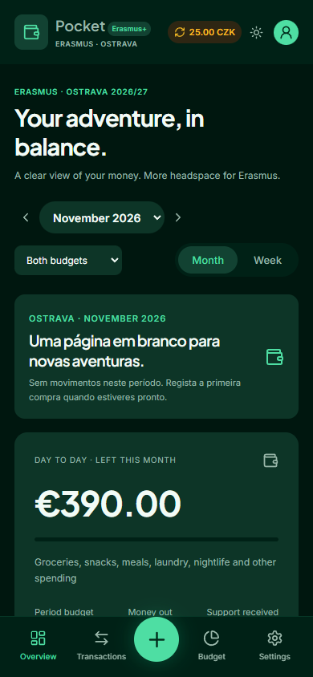

<p align="center">
  
</p>

<h1 align="center">Ostrava Pocket</h1>

<p align="center">
  A budget tracker for Erasmus life in Ostrava.<br>
  Track everyday spending in EUR, plan trips, and manage your prepaid laundry card in CZK.
</p>

<p align="center">
  <a href="#quick-start">Quick start</a> ·
  <a href="#how-the-budget-works">Budget guide</a> ·
  <a href="#backups-and-sync">Backups &amp; sync</a> ·
  <a href="#development">Development</a>
</p>

<p align="center">
  <code>React</code> · <code>TypeScript</code> · <code>Vite PWA</code> · <code>PT-PT / EN</code>
</p>

<p align="center">
  
  
</p>
<p align="center"><sub>Illustrative screenshots from an earlier build.</sub></p>

## What you can do

| Area             | What you can do                                                                                                                   |
| ---------------- | --------------------------------------------------------------------------------------------------------------------------------- |
| **Home**         | See what’s left in each budget, switch the category spending card between month and week, and add favorite expenses in one tap.   |
| **Analysis**     | Review spending patterns. Desktop adds budget pace, category distribution, weekly spending and laundry credit charts.             |
| **Movements**    | Record expenses and support in their original currency. Search, filter, edit and undo deletions. The desktop table can be sorted. |
| **Laundry card** | Top up, log a wash or dry, and adjust the real CZK balance. Set your own prices in Settings.                                      |
| **Settings**     | Set monthly plans, exchange rates and recurring rules. Switch languages, export data or connect an optional Supabase account.     |

The app starts with Portuguese (Portugal) and a dark theme by default. Language and theme choices are saved on the device.

## Quick start

Use **Node.js 24+**. From the repository root:

```sh
npm ci
npm run dev
```

Open the local URL printed by Vite. A new workspace starts empty and stores your data in the current browser.

For a local preview of the production PWA:

```sh
npm run build
npm run preview
```

To install it on a phone, open a deployed HTTPS version and use **Install app** on Android or **Share → Add to Home Screen** on iOS. The installed app can open offline. Sign-in, cloud sync and fresh exchange rates need a connection.

## How the budget works

The default monthly plan is **€550**, split between **€390 for day-to-day spending** and **€160 for travel and tourism**.

<details>
<summary>See the default allocations</summary>

| Category                | Monthly allocation |
| ----------------------- | -----------------: |
| Groceries & hygiene     |               €100 |
| Snacks & coffee         |                €45 |
| Restaurants & canteen   |                €75 |
| Laundry top-ups         |                €55 |
| Nightlife               |                €90 |
| Other                   |                €25 |
| **Day-to-day subtotal** |           **€390** |
| **Travel & tourism**    |           **€160** |
| **Total**               |           **€550** |

</details>

Travel uses one shared budget across transport, accommodation, food and activities. Support received adds to the available budget for its category and dated period. The app displays support and gross spending separately.

Edit allocations in **Settings → Monthly plan**. New workspaces cover four months starting with the current month in Ostrava. If tracking starts partway through a month, the first plan is prorated. Weekly limits follow the number of tracked days in the selected week. Monthly budgets reset while unused laundry credit carries over.

### Laundry credit

| Action             | Bank spending            | Laundry credit                                         |
| ------------------ | ------------------------ | ------------------------------------------------------ |
| **Top up**         | Records the amount spent | Increases the prepaid balance                          |
| **Wash or dry**    | €0                       | Deducts the service price                              |
| **Adjust balance** | €0                       | Corrects the recorded balance from the adjustment date |

The default prices are **110 CZK for a wash** and **60 CZK for drying**. Changing a price applies to new entries. The app rejects changes that would make the card balance negative.

### Currencies and recurring entries

Each movement stores its original amount, currency and saved EUR conversion. Latest Frankfurter reference rates are cached for offline use. For a currency without a cached rate, enter a manual rate. Backdated entries use the latest reference rate unless you override it.

Recurring rules support weekly or monthly expenses, support and laundry top-ups. They can post automatically or wait for confirmation. The app checks for due entries when it opens or resumes.

## Backups and sync

Open **Settings → Data** to export a **full JSON backup** containing movements, plans, settings, favorites and recurring rules. Restoring JSON replaces the current workspace after confirmation. CSV is useful for working with transactions in a spreadsheet. Import merges transactions by ID and updates laundry prices when the file includes them.

Keep exports somewhere private. JSON and CSV files are plain text.

<details>
<summary>Set up optional Supabase sync</summary>

1. Run [the schema](supabase/schema.sql) once in a new Supabase project.
2. Copy [`.env.example`](.env.example) to `.env.local` and set the URL and browser publishable key.

   ```dotenv
   VITE_SUPABASE_URL=https://your-project.supabase.co
   VITE_SUPABASE_PUBLISHABLE_KEY=sb_publishable_...
   ```

3. In Supabase, configure the app origin as the **Site URL** and allow it as an authentication redirect. For local testing, add the exact origin Vite prints.
4. Restart the dev server and request an email sign-in link under **Settings → Account**.
5. Use **Sync now** on each device to send or receive changes.

The guest workspace and signed-in workspace have separate data. To move guest data into an account, export JSON as a guest and import it after signing in. When two devices change the same version, the app asks which copy to keep and allows you to export both.

</details>

## Development

| Command                | Purpose                                                      |
| ---------------------- | ------------------------------------------------------------ |
| `npm test`             | Run accounting, validation, language, import and sync tests. |
| `npm run build`        | Check TypeScript and build the PWA into `dist/`.             |
| `npm run format:check` | Check source and documentation formatting.                   |

| Path                                                                | Responsibility                                           |
| ------------------------------------------------------------------- | -------------------------------------------------------- |
| [`src/model.ts`](src/model.ts)                                      | Budgets, transactions, validation and laundry accounting |
| [`src/store.ts`](src/store.ts) and [`src/sync.ts`](src/sync.ts)     | Local storage and optional cloud synchronisation         |
| [`src/views/`](src/views/) and [`src/components/`](src/components/) | Screens and shared controls                              |
| [`src/locales/`](src/locales/)                                      | English and Portuguese message catalogs                  |
| [`src/transfer.ts`](src/transfer.ts)                                | CSV import and export                                    |

For a Vercel deployment, build as a Vite project with Node.js 24, `npm run build`, and output directory `dist`. To enable sync on the deployment, configure the two Supabase environment variables and allow the production origin in Supabase Auth.

See the [verification notes](VERIFICATION.md), [design archive](docs/DESIGN.md) and [screen coverage](docs/COVERAGE.md) for earlier iterations and testing details.
