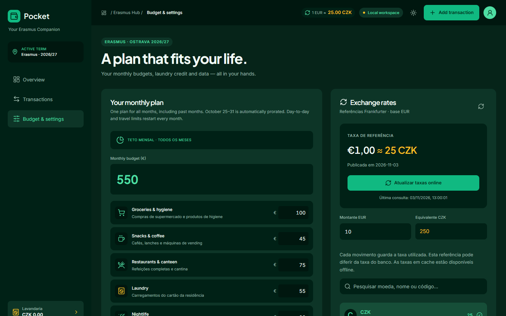

<p align="center">
  
</p>

<h1 align="center">Ostrava Pocket</h1>

<p align="center">
  An Erasmus budget tracker for Ostrava.<br>
  Everyday spending and travel in EUR · prepaid laundry in CZK.
</p>

<p align="center">
  <a href="#run-locally">Run locally</a> ·
  <a href="#data-and-sync">Data &amp; sync</a> ·
  <a href="VERIFICATION.md">Verification</a>
</p>

<p align="center">
  
  
</p>
<p align="center"><sub>Illustrative screenshots from an earlier build.</sub></p>

## Features

- **Budgets** for everyday spending and travel, with monthly and weekly views and category progress bars.
- **Movements** in multiple currencies, with favorites, recurring rules and desktop charts.
- **Laundry card** with top-ups, wash and dry shortcuts, configurable prices and balance adjustments.
- **Installable PWA** with offline storage, light and dark themes, and Portuguese (Portugal) and English.

## Run locally

Requires **Node.js 24+**.

```sh
npm ci
npm run dev
```

Open the URL printed by Vite. Run `npm test` to test the app or `npm run build` to build it for production.

## Data and sync

Export a full JSON backup or import JSON and CSV under **Settings → Data**. The app stores data in your browser by default.

<details>
<summary>Optional Supabase sync</summary>

1. Run [the schema](supabase/schema.sql) in a new Supabase project.
2. Copy [`.env.example`](.env.example) to `.env.local` and fill in the Supabase URL and browser publishable key.
3. Add the app origin to Supabase Auth as the site URL and an allowed redirect.
4. Sign in under **Settings → Account** and use **Sync now** on each device.

</details>
